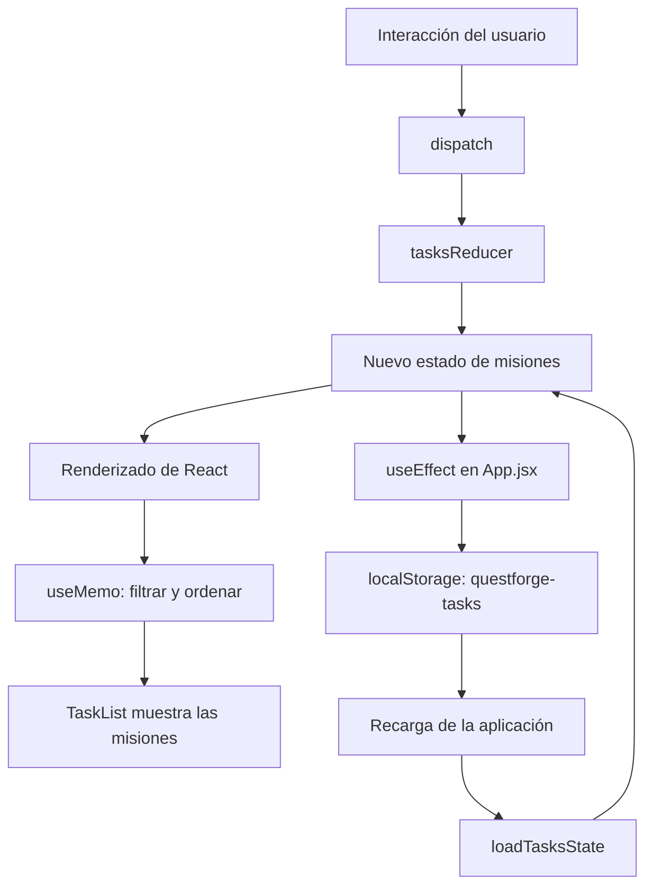

# QuestForge — Dashboard de Gestión de Misiones

**Universidad Nacional del Centro del Perú**  
Facultad de Ingeniería de Sistemas  
**Asignatura:** Desarrollo de Aplicaciones Web (IS093A)  
**Práctica:** Semana 07 — Segunda parte  
**Estudiante:** TORRES AMBROSIO KATHERINE MEDALLY

## 1. Descripción del proyecto

QuestForge es una aplicación web inspirada en un videojuego RPG que permite gestionar misiones mediante un dashboard interactivo. El usuario puede crear misiones, cambiar su estado, eliminarlas, filtrarlas y ordenarlas alfabéticamente. Además, la aplicación muestra estadísticas sobre las misiones registradas y la experiencia obtenida, y permite cambiar entre un tema claro y uno oscuro.

El proyecto se desarrolló con React y JavaScript utilizando Vite. Para gestionar el estado, sincronizar datos, reutilizar lógica y optimizar el procesamiento de las misiones, se utilizaron Hooks de React y un Hook personalizado para la persistencia en `localStorage`.

## 2. Tecnologías utilizadas

- **React y JavaScript:** desarrollo de componentes e interactividad.
- **Vite:** creación y ejecución del proyecto.
- **CSS:** diseño visual adaptable y estilos de los temas.
- **React Hooks:** gestión del estado, efectos, referencias y optimización.
- **localStorage:** almacenamiento local de misiones y preferencias.
- **ESLint:** revisión estática del código.
- **React DevTools Profiler:** observación de los renderizados de los componentes.

## 3. Funcionalidades implementadas

- Crear misiones con un título y una categoría.
- Asignar puntos de experiencia (XP) según la categoría de la misión.
- Marcar misiones como completadas o pendientes.
- Eliminar misiones registradas.
- Filtrar misiones por todas, pendientes o completadas.
- Ordenar las misiones alfabéticamente de A–Z o de Z–A.
- Cambiar entre tema claro y tema oscuro.
- Guardar las misiones y la preferencia de tema en `localStorage`.
- Mostrar el total de misiones, las completadas y la experiencia obtenida.
- Enfocar automáticamente el campo de texto y permitir acceder a él mediante la tecla `/`.

## 4. Implementación y justificación de los Hooks

### 4.1. `useState`

**Ubicación:** `src/components/TaskList.jsx`.

Se utiliza para controlar los valores locales del formulario: el título de la misión (`title`) y la categoría seleccionada (`category`). Estos valores cambian cuando el usuario escribe o selecciona una opción, por lo que `useState` resulta adecuado para manejar datos simples de la interfaz.

### 4.2. `useReducer`

**Ubicación:** `src/App.jsx` y `src/hooks/useTasksReducer.js`.

En `App.jsx`, `useReducer` administra el estado de las misiones mediante `tasksReducer` e `initialTasksState`. En `useTasksReducer.js` se encuentran las acciones `ADD`, `REMOVE`, `TOGGLE`, `FILTER` y `SORT`, que permiten agregar, eliminar, completar, filtrar y ordenar las misiones.

Se utiliza porque el estado tiene varias operaciones relacionadas. De esta manera, la lógica de actualización queda centralizada en el reducer en lugar de distribuirse entre numerosos estados independientes.

### 4.3. `useContext`

**Ubicación:** `src/contexts/ThemeContext.jsx` y `src/App.jsx`.

En `ThemeContext.jsx` se crea `ThemeContext` y se implementa `ThemeProvider`, que comparte el tema actual y la función `toggleTheme`. También se define el Hook personalizado `useTheme`, que permite acceder al contexto.

En `App.jsx`, el componente `Dashboard` utiliza `useTheme()` para obtener el tema y cambiarlo mediante el botón correspondiente. Así, las preferencias visuales se comparten sin necesidad de pasar estas propiedades manualmente por todos los componentes.

### 4.4. `useEffect`

**Ubicación:** `src/App.jsx`, `src/contexts/ThemeContext.jsx`, `src/hooks/useLocalStorage.js` y `src/components/TaskList.jsx`.

Se utiliza para sincronizar la aplicación con recursos externos y ejecutar acciones secundarias:

- **`src/App.jsx`:** guarda las misiones en `localStorage` cuando cambia `state.items`.
- **`src/contexts/ThemeContext.jsx`:** aplica el tema al atributo `data-theme` del elemento `body` y lo elimina durante la limpieza del efecto.
- **`src/hooks/useLocalStorage.js`:** sincroniza el valor administrado por el Hook personalizado con `localStorage`.
- **`src/components/TaskList.jsx`:** enfoca el campo de texto cuando cambia la cantidad de misiones y registra un evento de teclado para que la tecla `/` permita enfocar el campo. La función de limpieza elimina el evento con `removeEventListener` cuando el componente se desmonta.

### 4.5. `useMemo`

**Ubicación:** `src/components/TaskList.jsx`.

La variable `processedTasks` utiliza `useMemo` para obtener la lista visible según el filtro seleccionado y ordenarla alfabéticamente. El cálculo se vuelve a ejecutar cuando cambian `tasks`, `filter` o `sort`.

Esto permite reutilizar el resultado mientras las dependencias no cambien, evitando repetir innecesariamente el procesamiento de la lista en cada renderizado.

### 4.6. `useCallback`

**Ubicación:** `src/components/TaskList.jsx` y `src/contexts/ThemeContext.jsx`.

En `TaskList.jsx` se utiliza para definir las funciones `handleRemove`, `handleToggle`, `handleFilter`, `handleSort` y `handleSubmit`. En `ThemeContext.jsx`, `toggleTheme` se define con `useCallback` para conservar su referencia entre renderizados mientras sus dependencias permanezcan iguales.

Estas funciones permiten organizar los manejadores de eventos y conservar sus referencias cuando sus dependencias no cambian. Su beneficio en el rendimiento depende de cómo se utilicen y de si los componentes consumidores pueden aprovechar esas referencias estables.

### 4.7. `useRef`

**Ubicación:** `src/components/TaskList.jsx`.

Se declara `inputRef` para obtener una referencia directa al campo de texto del formulario. Se utiliza con `inputRef.current?.focus()` para enfocar el campo cuando cambia la cantidad de misiones y cuando el usuario presiona `/`, siempre que no esté escribiendo en otro campo de entrada.

A diferencia de `useState`, modificar una referencia no provoca por sí mismo un nuevo renderizado. En este caso, `useRef` facilita la interacción directa con el elemento del DOM.

### 4.8. Hook personalizado `useLocalStorage`

**Ubicación:** `src/hooks/useLocalStorage.js`.

Se implementó `useLocalStorage(key, defaultValue)` para reutilizar la lógica de lectura y escritura de valores en `localStorage`. Inicializa el estado con el valor almacenado o con un valor predeterminado y utiliza `useEffect` para guardar los cambios. También emplea `useCallback` para proporcionar una función de actualización estable.

Este Hook se utiliza en `src/contexts/ThemeContext.jsx` para conservar la preferencia del tema claro u oscuro. Las misiones se guardan por separado desde `src/App.jsx`.

## 5. Diagrama del flujo del estado

El siguiente diagrama representa el flujo implementado para administrar y guardar las misiones.



La aplicación inicia el estado de las misiones mediante `loadTasksState()` en `src/App.jsx`, que recupera los datos guardados o utiliza las misiones iniciales. Cuando el usuario realiza una acción, `dispatch` envía una acción al reducer, que devuelve el nuevo estado. React actualiza la interfaz y el efecto guarda los cambios en `localStorage`.

La preferencia del tema sigue un flujo independiente mediante `useLocalStorage`, implementado en `src/hooks/useLocalStorage.js` y utilizado desde `src/contexts/ThemeContext.jsx`.

## 6. Validación y resultados obtenidos

### 6.1. Revisión del código con ESLint

Se ejecutó el siguiente comando en la terminal de VS Code:

```bash
npm run lint
```

**Resultado:** el comando finalizó sin mostrar errores ni advertencias en la terminal. Esto confirma que la revisión de ESLint se completó correctamente con la configuración actual del proyecto.

### 6.2. Compilación del proyecto

Se ejecutó:

```bash
npm run build
```

**Resultado:** la compilación finalizó correctamente con Vite 8.3.4. Se transformaron 21 módulos y se generaron los archivos de producción dentro de la carpeta `dist`.

### 6.3. Inspección con React DevTools Profiler

Se abrió React DevTools Profiler en el navegador y se registró una interacción al agregar una misión. En la captura se observa el renderizado de `TaskList` y la información de duración del commit registrado.

Esta inspección permitió observar qué componente se renderizó durante la interacción. El registro corresponde a una observación del comportamiento de la aplicación; por sí solo no demuestra una reducción de renderizados causada por `useMemo` o `useCallback`.

### 6.4. Limpieza de efectos

En `src/components/TaskList.jsx` se verificó en el código que el evento `keydown` se registra con `window.addEventListener` y se elimina mediante `window.removeEventListener` en la función de limpieza del efecto.

Esta implementación evita mantener ese listener asociado al componente después de su desmontaje. La evidencia presentada corresponde a la revisión del código de limpieza.

### 6.5. Funcionamiento de la interfaz

En el navegador se observó el dashboard de QuestForge con sus estadísticas, el formulario para registrar misiones, los controles de filtrado y ordenamiento y el botón para cambiar de tema. También se registró una interacción en la que el total de misiones pasó de tres a cuatro, mientras las misiones completadas y la experiencia obtenida permanecieron iguales.

## 7. Evidencias

Las capturas de pantalla tomadas durante la práctica muestran:

1. La ejecución de `npm run lint` sin errores visibles.
2. La compilación exitosa mediante `npm run build`.
3. El dashboard de QuestForge ejecutándose en el navegador.
4. El registro de una interacción con React DevTools Profiler.
5. La selección de `TaskList` y `Dashboard` en el Profiler para observar los componentes.
6. El código de `useEffect` en `TaskList.jsx`, incluido el registro y la limpieza del evento de teclado.
7. La estructura de carpetas y archivos del proyecto en VS Code.

Estas evidencias documentan la ejecución, la compilación, la inspección de renderizados y las implementaciones realizadas en el código.

## 8. Conclusiones

El desarrollo de QuestForge permitió aplicar diferentes Hooks de React en una aplicación interactiva. `useReducer` centraliza las operaciones de las misiones, `useContext` comparte la preferencia del tema y `useEffect` sincroniza los datos con `localStorage` y administra el evento de teclado con su respectiva limpieza.

Asimismo, `useMemo` permite procesar la lista según el filtro y el orden seleccionados; `useCallback` conserva referencias de funciones cuando sus dependencias no cambian, y `useRef` permite enfocar el campo de texto sin utilizar estado para esa referencia. El Hook personalizado `useLocalStorage` reutiliza la lógica de persistencia de las preferencias.

Finalmente, las ejecuciones de `npm run lint` y `npm run build` finalizaron correctamente. React DevTools Profiler permitió observar el renderizado de los componentes durante una interacción, proporcionando una primera aproximación al análisis del comportamiento de la aplicación.
