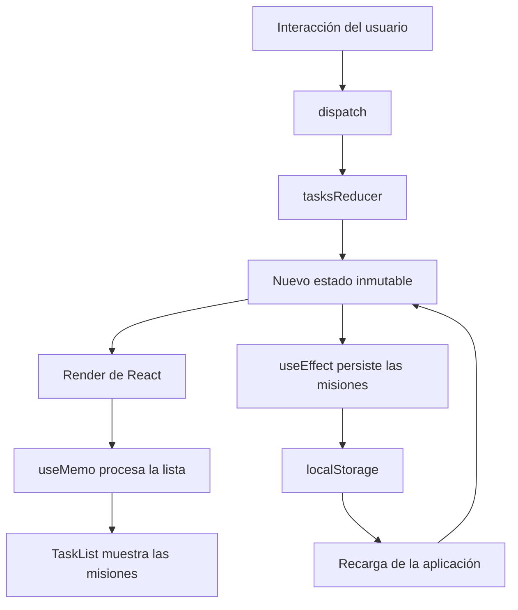

# QuestForge — Dashboard de Gestión de Misiones

**Universidad Nacional del Centro del Perú**  
Facultad de Ingeniería de Sistemas  
Asignatura: Desarrollo de Aplicaciones Web (IS093A)  
Práctica: Semana 07 — Segunda parte
Estudiante: TORRES AMBROSIO KATHERINE MEDALLY

## 1. Descripción del proyecto

QuestForge es un dashboard inspirado en un videojuego RPG que permite gestionar misiones, registrar su progreso, obtener experiencia y visualizar estadísticas.

## 2. Tecnologías utilizadas

- React y JavaScript.
- Vite.
- CSS.
- React Hooks.
- localStorage.
- ESLint y React DevTools Profiler.

## 3. Funcionalidades

- Crear, completar y eliminar misiones.
- Filtrar misiones por estado.
- Ordenar misiones alfabéticamente.
- Cambiar entre tema claro y oscuro.
- Persistir misiones y preferencias.
- Mostrar estadísticas de experiencia y progreso.

## 4. Justificación de los Hooks

| Hook | Justificación |
|---|---|
| useState | Administra valores locales del formulario. |
| useReducer | Centraliza las acciones y el estado complejo de las misiones. |
| useContext | Comparte las preferencias del tema. |
| useEffect | Sincroniza datos externos y registra efectos con cleanup. |
| useMemo | Memoriza el procesamiento de la lista según sus dependencias. |
| useCallback | Conserva referencias de funciones cuando resulta útil. |
| useRef | Permite acceder al input sin provocar renders por el cambio de referencia. |
| useLocalStorage | Reutiliza la lógica de persistencia. |

## 5. Diagrama de flujo del estado

## 6. Validación

Documentar los resultados reales de:

- npm run lint
- npm run build
- React DevTools Profiler
- Persistencia de datos y preferencias.
- Cleanup de useEffect.

## 7. Evidencias

Incluir las capturas de pantalla de la ejecución,
las funcionalidades, las validaciones y el Profiler.

## 8. Conclusiones

Redactar las conclusiones después de completar
las pruebas y analizar los resultados obtenidos.
